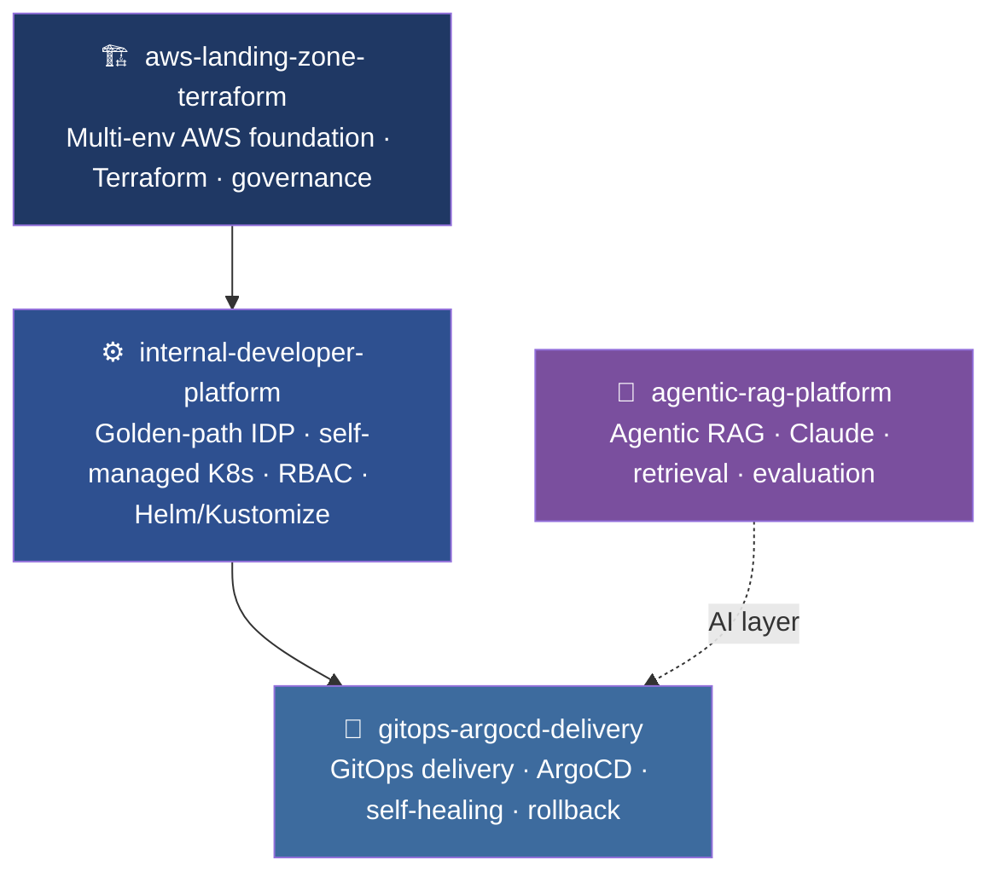

# Kevin Christopher Clement

**Cloud & DevOps Architect | AI Platform Engineering**

I build the platforms teams ship on — cloud landing zones, self-managed Kubernetes, GitOps delivery, DevSecOps — and increasingly the **agentic AI systems** that run inside the software delivery lifecycle itself. 11 years across **AWS and Azure**; one of the few platform architects who also ships production AI.

🏆 **Winner — "AI in SDLC", TCS Engineering Excellence Expo 2026**, for an agentic AI delivery platform.

---

### Flagship platform — one system, four layers

> Foundation → Platform → Delivery, with an agentic-AI layer on top. Each links below as it goes live.

---

### What I work on

- **Cloud & Platform Architecture** — AWS & Azure, landing zones, multi-account/multi-subscription governance, cost & security frameworks
- **Kubernetes & GitOps** — self-managed clusters (kubeadm), Helm/Kustomize, ArgoCD delivery, drift detection & self-healing
- **DevSecOps** — supply-chain security, image signing, SonarQube/Trivy/OWASP in CI/CD
- **AI Platform Engineering** — agentic AI, LLM/RAG pipelines, Anthropic Claude, Model Context Protocol (MCP), Azure AI Foundry

**Currently:** building production-grade, open-source platform + agentic-AI projects (linked above as they ship).

---

### Certifications

- **AWS Certified DevOps Engineer – Professional**
- **Microsoft Certified: Azure DevOps Expert**
- **Microsoft Certified: Azure Developer Associate**
- **Microsoft Certified: AI-103** — Developing AI Apps and Agents on Azure
- **Anthropic Claude Certified Architect – Foundations**

---

### Tech

`AWS` · `Azure` · `Kubernetes` · `Terraform` · `Ansible` · `Helm` · `ArgoCD` · `Docker` · `GitHub Actions` · `Jenkins` · `Prometheus` · `Grafana` · `Python` · `Claude API` · `MCP` · `Azure AI Foundry`

---

📫 **[LinkedIn](https://linkedin.com/in/kevincclement)**
